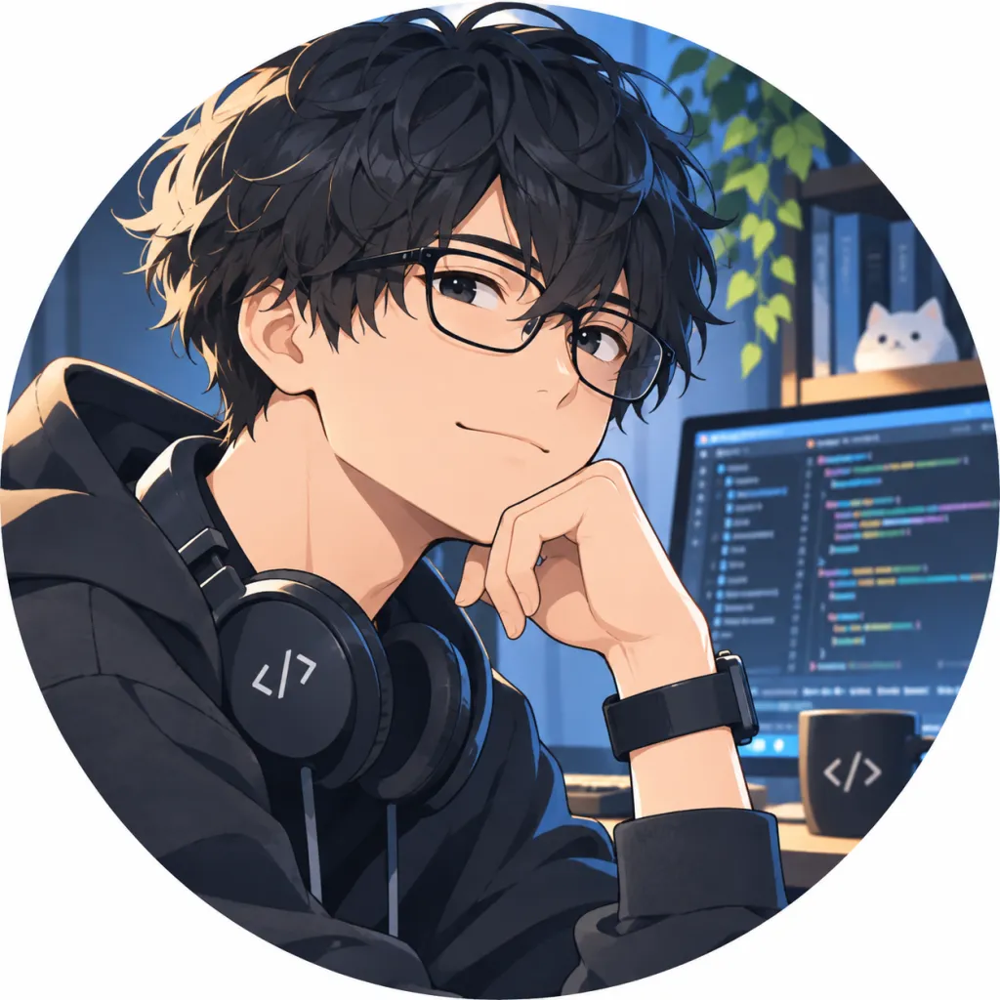
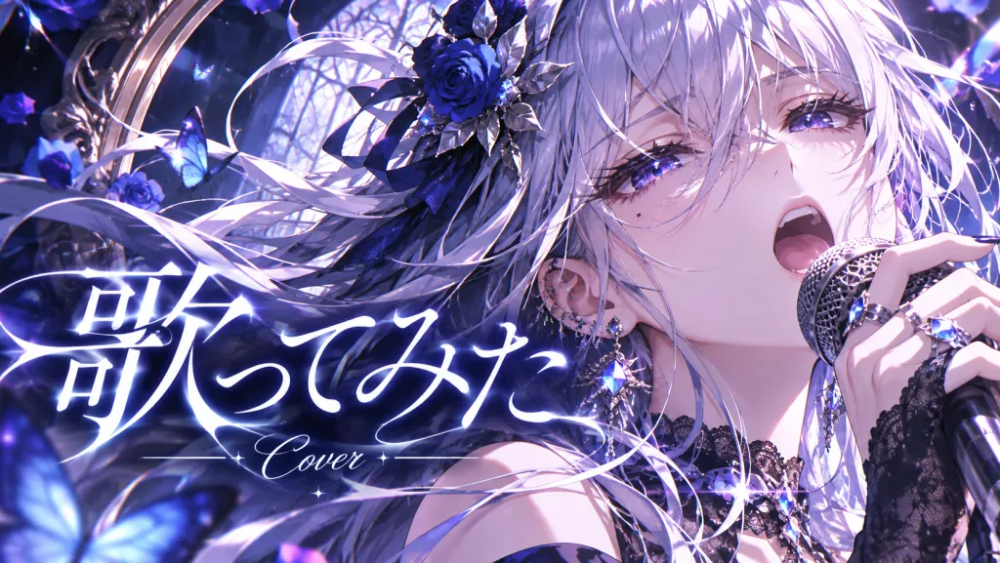
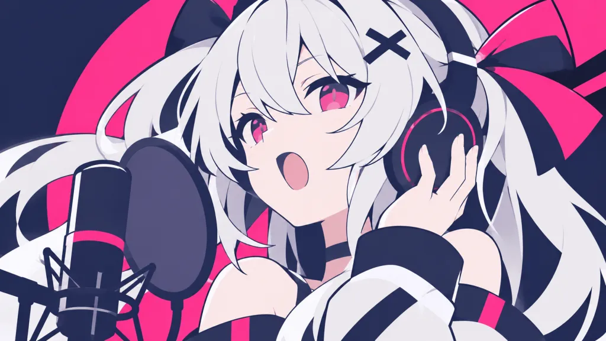
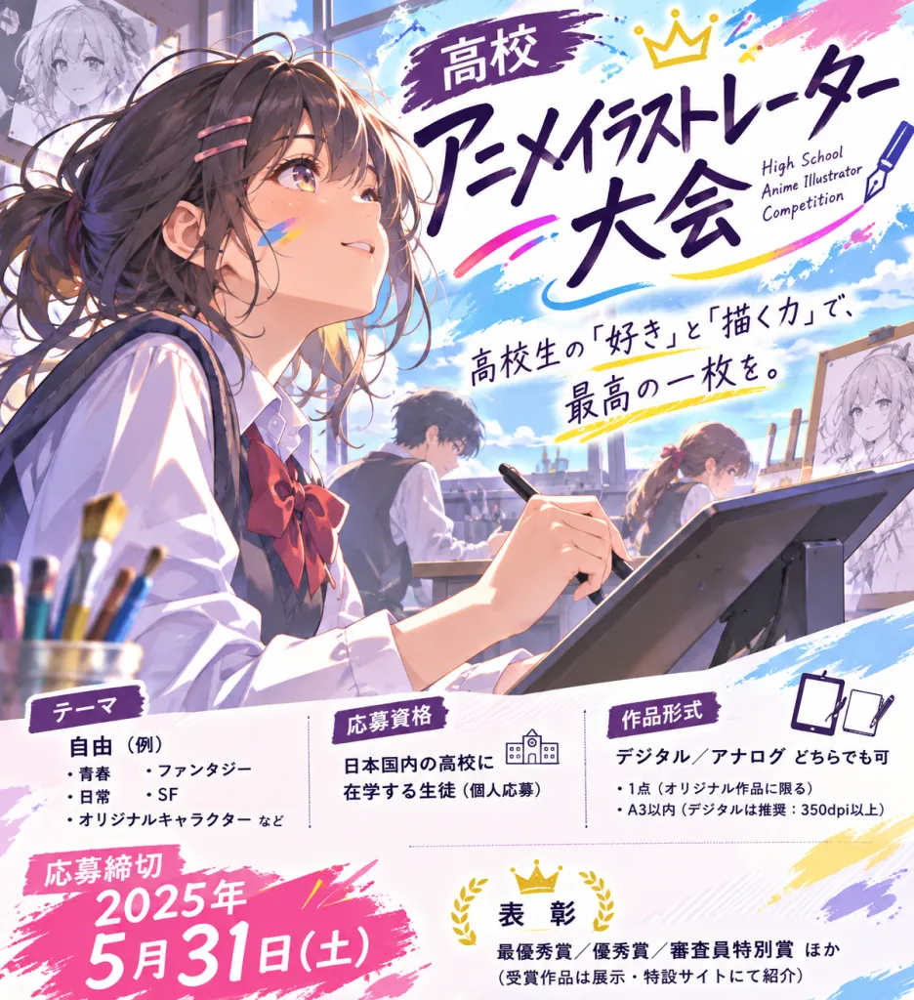
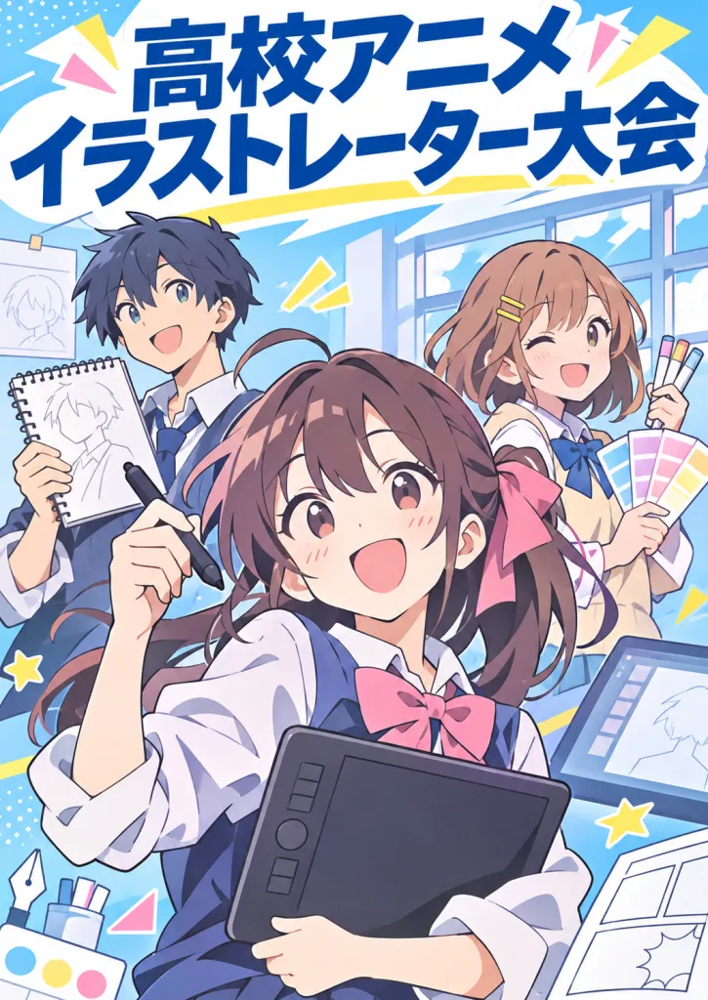
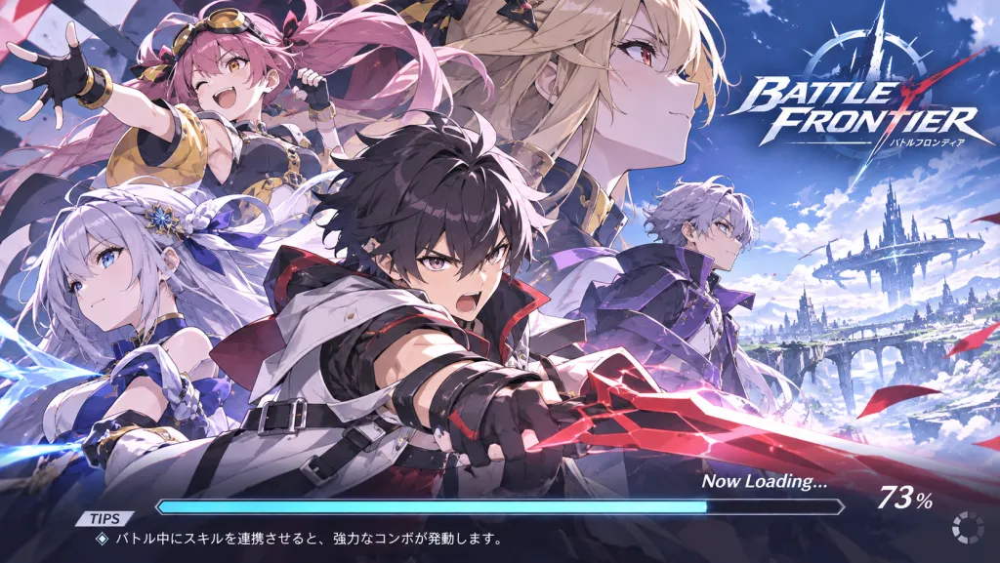
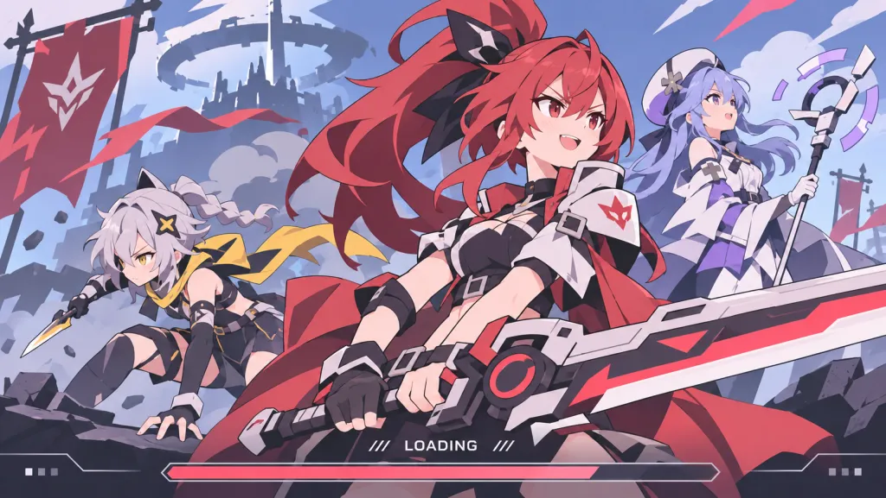
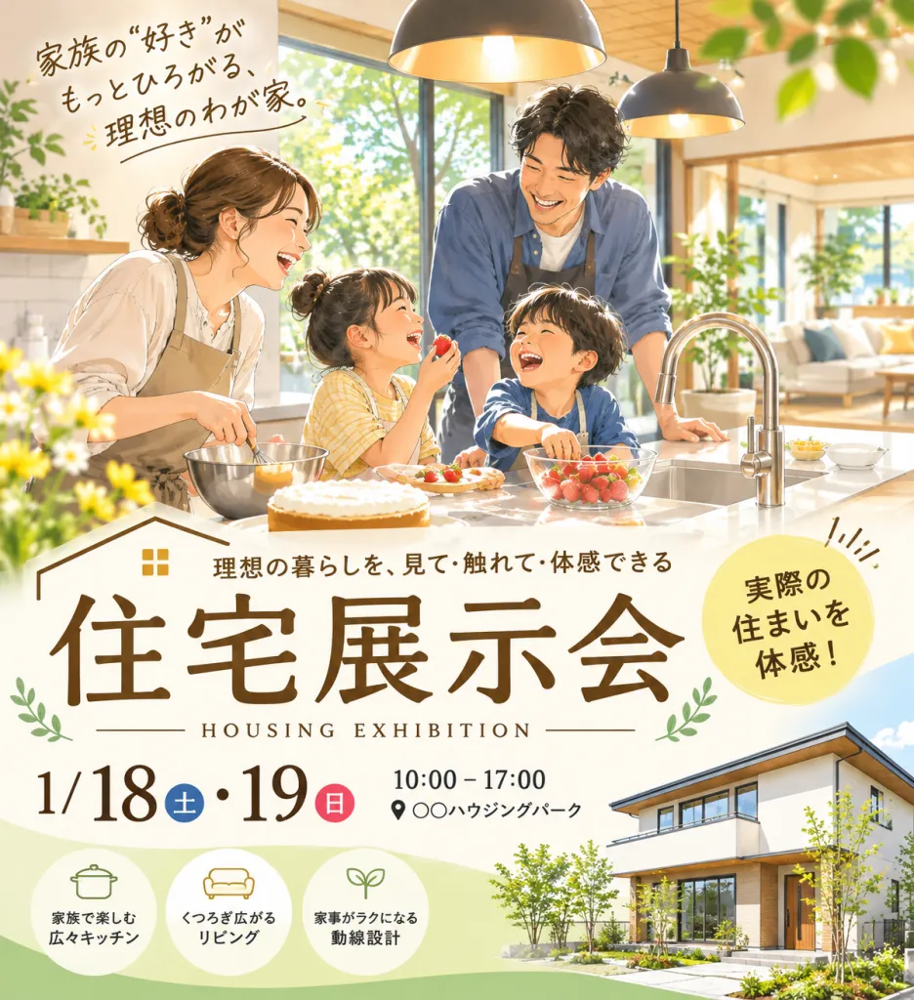

# イラスト制作

AI らしさを抑えるためのルールです。画像生成のプロンプトに追加して使います。

```text
イラスト制作では、以下のルールを守る。
- 写真をイラスト化したような写実表現を避け、線と色面で構成された2Dイラストとして描く。
- 陰影はシンプルにし、過剰な光沢、反射、発光、ハイライト、細かなグラデーションを避ける。配色やコントラストは題材に合わせる。
- 描き込みには明確な強弱をつける。見せたい部分以外は大胆に省略し、背景や小道具も必要な特徴だけを描く。
- 現実の正確な再現より、イラストとして見栄えのよい形状の単純化やデフォルメを優先する。
- 線の太さや密度に強弱をつける。髪は一本ずつ描かず、まとまった毛束で表現する。
- 人物は写実的な美人顔より、柔らかく可愛らしいキャラクター造形を優先する。設定年齢は維持し、顔のパーツと陰影を簡略化する。
- 表情とポーズは人物の性格や状況に合わせ、感情が伝わる自然な描写にする。過剰な演技は避ける。
- 指示のない文字は追加しない。必要な文字は原則として角ゴシック体を使う。
```

## 比較

画像はすべて ChatGPT で生成しています。

### アイコン

```text
Twitteアイコンとしてで使用するエンジニアの自画像のイラスト作成して
```

| 追加なし | 追加あり |
| --- | --- |
|  |  |

### 動画サムネイル

```text
vtuberの歌ってみた動画のサムネを作成して。
ガッと目を引くほど美しいやつ
```

| 追加なし | 追加あり |
| --- | --- |
|  |  |

### 大会のポスター

```text
高校アニメイラストレーター大会のポスターを作成して
```

| 追加なし | 追加あり |
| --- | --- |
|  |  |

### ゲームのロード画面

```text
新作バトルゲームのロード画面を作成してください。
アニメっぽい絵柄のゲームです。
```

| 追加なし | 追加あり |
| --- | --- |
|  |  |

### 展示会のポスター

```text
住宅展示会のポスターイラストを作成して。
家族がキッチンで和気藹々している構図
```

| 追加なし | 追加あり |
| --- | --- |
|  |  |
